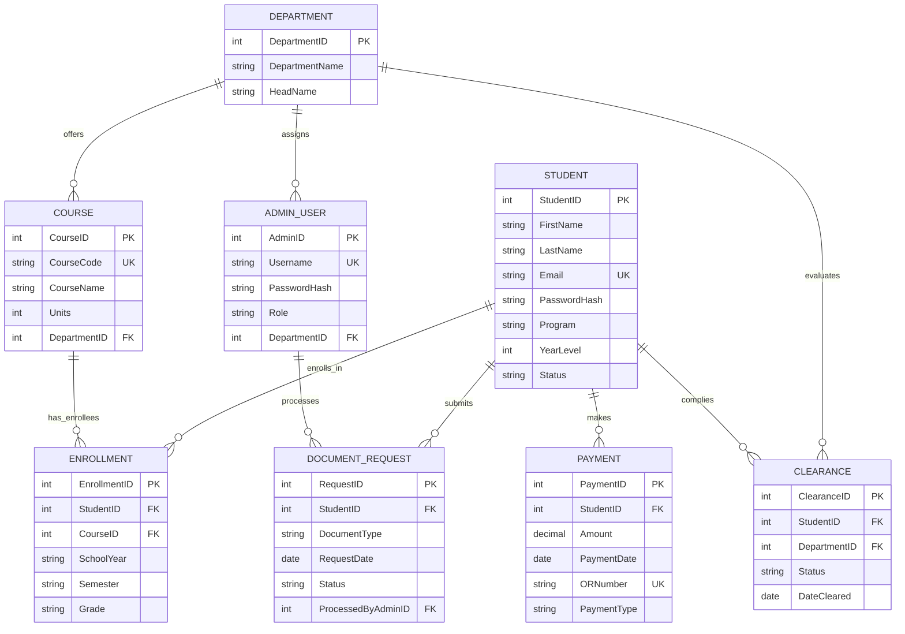

# B. Database Design & Normalization (3NF)
**CuyoTech University — Student Services Information System (SSIS)**  
**Course:** CCS109 — Final Project Case Study  

---

## 1. Entity-Relationship Diagram (ERD)

---

## 2. Normalization Process (UNF to 3NF)

### Phase 1: Unnormalized Form (UNF)
In an unnormalized student record, a single flat record contains repeating groups of enrolled courses, grades, document requests, payments, and multiple clearance statuses:

$$\text{UNF} = \{ \underline{\text{StudentID}}, \text{FirstName}, \text{LastName}, \text{Email}, \text{Program}, \text{YearLevel}, (\text{CourseCode}, \text{CourseName}, \text{Units}, \text{Grade}, \text{Semester}, \text{SchoolYear})^*, (\text{PaymentDate}, \text{Amount}, \text{ORNumber}, \text{PaymentType})^*, (\text{RequestID}, \text{DocType}, \text{DocStatus})^*, (\text{DepartmentName}, \text{ClearanceStatus})^* \}$$

---

### Phase 2: First Normal Form (1NF)
**Rule:** Eliminate repeating groups and ensure all attributes contain atomic (indivisible) values. Define primary keys for each table.

- Separated repeating courses into `Enrollment` and `Course`.
- Separated repeating payments into `Payment`.
- Separated repeating document requests into `DocumentRequest`.
- Separated repeating clearance evaluations into `Clearance`.
- Ensured atomic attributes: separated student names into `FirstName` and `LastName`.

---

### Phase 3: Second Normal Form (2NF)
**Rule:** Must be in 1NF and have **no partial functional dependencies** (every non-key attribute must depend on the entire primary key, not just part of a composite key).

In composite entities such as `Enrollment` and `Clearance`:
- **Enrollment:** Composite candidate key is $(\text{StudentID}, \text{CourseID}, \text{SchoolYear}, \text{Semester})$.
  - $\text{Grade}$ depends on the **entire composite key** (a student receives a grade for a specific course in a specific term).
  - Course attributes ($\text{CourseName}, \text{Units}$) depend **only** on $\text{CourseID}$, not on $\text{StudentID}$. Thus, course details were separated into the dedicated `Course` table to eliminate partial dependencies:
    $$\text{CourseID} \to \text{CourseCode}, \text{CourseName}, \text{Units}, \text{DepartmentID}$$
- **Clearance:** Composite candidate key is $(\text{StudentID}, \text{DepartmentID})$.
  - $\text{Status}$ and $\text{DateCleared}$ depend on the full combination of $(\text{StudentID}, \text{DepartmentID})$.
  - Department attributes ($\text{DepartmentName}, \text{HeadName}$) depend **only** on $\text{DepartmentID}$, separated into `Department`.

---

### Phase 4: Third Normal Form (3NF)
**Rule:** Must be in 2NF and have **no transitive functional dependencies** (no non-key attribute depends on another non-key attribute: if $X \to Y$ and $Y \to Z$, then $Z$ must not transitively depend on the primary key $X$).

- **In `Student`:** $\text{StudentID} \to \text{FirstName}, \text{LastName}, \text{Email}, \text{PasswordHash}, \text{Program}, \text{YearLevel}, \text{Status}$. No non-key attributes determine other non-key attributes.
- **In `Course`:** Does not store Department details ($\text{HeadName}$). Instead, it holds foreign key $\text{DepartmentID} \to \text{Department}$.
- **In `AdminUser`:** Stores foreign key $\text{DepartmentID}$ instead of duplicating office descriptions.
- **In `DocumentRequest`:** Stores $\text{StudentID}$ and $\text{ProcessedByAdminID}$ as foreign keys. It does not store student names or admin emails, eliminating transitive dependencies.
- **In `Payment`:** Stores $\text{StudentID}$ directly. Payment details do not redundantly store student demographic data.

---

## 3. 3NF Table Designs (8 Tables Specification)

### Table 1: `Department`
*Represents academic colleges and administrative offices that issue clearances and courses.*

| Field | Type | Null | Key | Default | Description |
|---|---|---|---|---|---|
| `DepartmentID` | INT | NO | **PK** | AUTO_INCREMENT | Unique identifier for department/office |
| `DepartmentName` | VARCHAR(100) | NO | | | Official name (e.g. CCS, Registrar, Cashier, Library) |
| `HeadName` | VARCHAR(100) | YES | | NULL | Name of department chair, director, or head |

**Functional Dependencies:**  
$$\text{DepartmentID} \to \text{DepartmentName}, \text{HeadName}$$

---

### Table 2: `Student`
*Stores student credentials, identity, and academic profile.*

| Field | Type | Null | Key | Default | Description |
|---|---|---|---|---|---|
| `StudentID` | INT | NO | **PK** | AUTO_INCREMENT | Unique student account number |
| `FirstName` | VARCHAR(50) | NO | | | Student given name |
| `LastName` | VARCHAR(50) | NO | | | Student surname |
| `Email` | VARCHAR(100) | NO | **UK** | | Institutional email address (unique) |
| `PasswordHash` | VARCHAR(255) | NO | | | Secure bcrypt hashed password |
| `Program` | VARCHAR(100) | YES | | | Academic degree (e.g. BS Information Technology) |
| `YearLevel` | INT | YES | | 1 | Current curriculum year level (1–4) |
| `Status` | VARCHAR(20) | YES | | 'Active' | Account standing ('Active', 'Deactivated', 'Graduated') |

**Functional Dependencies:**  
$$\text{StudentID} \to \text{FirstName}, \text{LastName}, \text{Email}, \text{PasswordHash}, \text{Program}, \text{YearLevel}, \text{Status}$$  
$$\text{Email} \to \text{StudentID}$$

---

### Table 3: `AdminUser`
*Stores administrative and registrar personnel accounts.*

| Field | Type | Null | Key | Default | Description |
|---|---|---|---|---|---|
| `AdminID` | INT | NO | **PK** | AUTO_INCREMENT | Unique administrator ID |
| `Username` | VARCHAR(50) | NO | **UK** | | Login username |
| `PasswordHash` | VARCHAR(255) | NO | | | Secure bcrypt hashed password |
| `Role` | VARCHAR(30) | NO | | | System role ('Registrar', 'Cashier', 'SuperAdmin') |
| `DepartmentID` | INT | YES | **FK** | NULL | Associated department (references `Department.DepartmentID`) |

**Functional Dependencies:**  
$$\text{AdminID} \to \text{Username}, \text{PasswordHash}, \text{Role}, \text{DepartmentID}$$  
$$\text{Username} \to \text{AdminID}$$

---

### Table 4: `Course`
*Defines subjects offered across academic departments.*

| Field | Type | Null | Key | Default | Description |
|---|---|---|---|---|---|
| `CourseID` | INT | NO | **PK** | AUTO_INCREMENT | Internal course catalog key |
| `CourseCode` | VARCHAR(20) | NO | **UK** | | Official course code (e.g. 'IT 311', 'IT 312') |
| `CourseName` | VARCHAR(100) | NO | | | Descriptive course title |
| `Units` | INT | NO | | 3 | Credit units |
| `DepartmentID` | INT | NO | **FK** | | Department offering course (references `Department.DepartmentID`) |

**Functional Dependencies:**  
$$\text{CourseID} \to \text{CourseCode}, \text{CourseName}, \text{Units}, \text{DepartmentID}$$  
$$\text{CourseCode} \to \text{CourseID}$$

---

### Table 5: `Enrollment`
*Associative entity resolving the Many-to-Many relationship between Student and Course with term grades.*

| Field | Type | Null | Key | Default | Description |
|---|---|---|---|---|---|
| `EnrollmentID` | INT | NO | **PK** | AUTO_INCREMENT | Unique enrollment record ID |
| `StudentID` | INT | NO | **FK** | | References `Student.StudentID` |
| `CourseID` | INT | NO | **FK** | | References `Course.CourseID` |
| `SchoolYear` | VARCHAR(9) | NO | | | Academic year (e.g. '2025-2026') |
| `Semester` | VARCHAR(10) | NO | | | Academic term ('1st', '2nd', 'Summer') |
| `Grade` | VARCHAR(5) | YES | | NULL | Grade mark (e.g. '1.25', '1.50', NULL if in progress) |

**Constraints:**  
- `UNIQUE (StudentID, CourseID, SchoolYear, Semester)`

**Functional Dependencies:**  
$$\text{EnrollmentID} \to \text{StudentID}, \text{CourseID}, \text{SchoolYear}, \text{Semester}, \text{Grade}$$  
$$\text{StudentID}, \text{CourseID}, \text{SchoolYear}, \text{Semester} \to \text{Grade}$$

---

### Table 6: `Payment`
*Tracks tuition, matriculation, and official receipt transactions.*

| Field | Type | Null | Key | Default | Description |
|---|---|---|---|---|---|
| `PaymentID` | INT | NO | **PK** | AUTO_INCREMENT | Unique transaction key |
| `StudentID` | INT | NO | **FK** | | References `Student.StudentID` |
| `Amount` | DECIMAL(10,2) | NO | | | Monetary amount in PHP |
| `PaymentDate` | DATE | NO | | | Date of payment receipt |
| `ORNumber` | VARCHAR(30) | NO | **UK** | | Official Receipt Number (unique) |
| `PaymentType` | VARCHAR(30) | NO | | | Type of fee ('Tuition', 'Document Fee', 'Miscellaneous') |

**Functional Dependencies:**  
$$\text{PaymentID} \to \text{StudentID}, \text{Amount}, \text{PaymentDate}, \text{ORNumber}, \text{PaymentType}$$  
$$\text{ORNumber} \to \text{PaymentID}$$

---

### Table 7: `DocumentRequest`
*Tracks student requests for academic documents and registrar fulfillment.*

| Field | Type | Null | Key | Default | Description |
|---|---|---|---|---|---|
| `RequestID` | INT | NO | **PK** | AUTO_INCREMENT | Unique request tracking code |
| `StudentID` | INT | NO | **FK** | | References `Student.StudentID` |
| `DocumentType` | VARCHAR(30) | NO | | | Document requested ('TOR', 'COR', 'Certification') |
| `RequestDate` | DATE | NO | | | Date request was lodged |
| `Status` | VARCHAR(20) | YES | | 'Pending' | Status ('Pending', 'Processing', 'Ready for release', 'Released') |
| `ProcessedByAdminID` | INT | YES | **FK** | NULL | References `AdminUser.AdminID` |

**Functional Dependencies:**  
$$\text{RequestID} \to \text{StudentID}, \text{DocumentType}, \text{RequestDate}, \text{Status}, \text{ProcessedByAdminID}$$

---

### Table 8: `Clearance`
*Associative entity resolving the Many-to-Many clearance relationship between Student and Department.*

| Field | Type | Null | Key | Default | Description |
|---|---|---|---|---|---|
| `ClearanceID` | INT | NO | **PK** | AUTO_INCREMENT | Unique clearance record ID |
| `StudentID` | INT | NO | **FK** | | References `Student.StudentID` |
| `DepartmentID` | INT | NO | **FK** | | References `Department.DepartmentID` |
| `Status` | VARCHAR(20) | YES | | 'Pending' | Status ('Pending', 'Cleared', 'Hold') |
| `DateCleared` | DATE | YES | | NULL | Timestamp/date of clearance approval |

**Constraints:**  
- `UNIQUE (StudentID, DepartmentID)`

**Functional Dependencies:**  
$$\text{ClearanceID} \to \text{StudentID}, \text{DepartmentID}, \text{Status}, \text{DateCleared}$$  
$$\text{StudentID}, \text{DepartmentID} \to \text{Status}, \text{DateCleared}$$

---

## 4. Relationship Summary & Cardinality Matrix

| Relationship | Entities | Type | Foreign Key Constraint |
|---|---|---|---|
| Department offers Courses | `Department` (1) $\to$ `Course` (M) | 1:M | `Course.DepartmentID` $\to$ `Department.DepartmentID` |
| Department employs Admin Staff | `Department` (1) $\to$ `AdminUser` (M) | 1:M | `AdminUser.DepartmentID` $\to$ `Department.DepartmentID` |
| Students enroll in Courses | `Student` (M) $\leftrightarrow$ `Course` (M) via `Enrollment` | M:N | Resolved by `Enrollment` table |
| Student issues Payments | `Student` (1) $\to$ `Payment` (M) | 1:M | `Payment.StudentID` $\to$ `Student.StudentID` |
| Student lodges Requests | `Student` (1) $\to$ `DocumentRequest` (M) | 1:M | `DocumentRequest.StudentID` $\to$ `Student.StudentID` |
| Admin processes Requests | `AdminUser` (1) $\to$ `DocumentRequest` (M) | 1:M | `DocumentRequest.ProcessedByAdminID` $\to$ `AdminUser.AdminID` |
| Student cleared by Offices | `Student` (M) $\leftrightarrow$ `Department` (M) via `Clearance` | M:N | Resolved by `Clearance` table |
